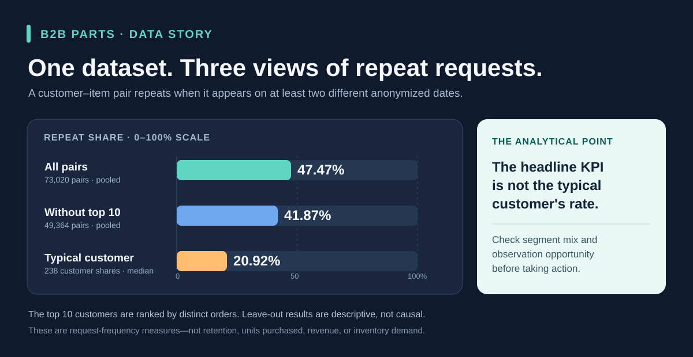

# B2B Parts Demand Patterns

**An AI-assisted, reproducible SQL + Power BI portfolio case study** using the anonymized [B2B-Parts-Rec v1](https://zenodo.org/records/19492687) dataset.



## The story in 30 seconds

**Business question:** Are industrial-parts requests concentrated among a few customers, and does the headline repeat-request rate describe a typical customer?

**Finding:** The top 10 customers generate **58.96% of distinct orders**. Across all 73,020 customer–item pairs, **47.47%** appear on at least two different anonymized dates. Yet the **median customer-level share is 20.92%**. Excluding the 10 customers with the most orders lowers the pooled pair rate to **41.87%**. The overall KPI therefore needs customer-level context before anyone interprets it as typical customer behavior.

**Business use:** Investigate dependence on high-order customers and compare repeat-request patterns among customers with similar observation opportunities. These results identify questions for a procurement team; the dataset does not contain the quantities, inventory, supplier, or cost data needed to set stock levels or claim savings.

Read the [portfolio case study](docs/portfolio-case-study.md) for the evidence, method, interpretation, and a short Chinese summary.

## Questions we are still exploring

The results above describe what happened in this dataset. They also leave us with some practical questions:

1. **Are customers really that different?** Some customers have been observed for longer or have placed more orders, giving us more chances to see a repeat request. Would the differences remain if we compared customers over similar time windows?
2. **What would a useful recommendation look like?** Would customers benefit more from finding a part they have requested before, or from discovering a part they have not requested before? Could this differ for customers with more or less order history?
3. **Who would use the recommendation, and how would we know it helped?** A buyer and a supplier's customer service team may need different things. We could first check whether suggested items appear in later requests, but that alone would not tell us whether the recommendations saved time or helped someone make a decision.

These are questions for further work, not conclusions or a finished research proposal.

## What is not yet resolved

- **Fairer comparisons:** The report includes a group with at least 10 orders, but it does not yet compare customers using the same follow-up period. A low repeat share may partly reflect fewer chances to observe a repeat.
- **A recommendation test:** The project describes past requests; it does not yet build or evaluate a recommendation model. The 47.47% figure is not a recommendation accuracy score or the probability that the next request will repeat an item.
- **Practical value:** We have not tested the report or recommendations with buyers or supplier teams. The data lacks quantities, inventory, delivery, suppliers, and total order values, so it cannot establish savings or prescribe stock levels.
- **Checks and reporting:** Current automated checks validate key database figures, but do not compare every exported CSV value with the database. The Power BI report is a saved snapshot, and the 41.87% sensitivity result shown above is not yet included in its pages.

For a next step, we plan to compare repeat patterns over similar observation windows and make the different repeat definitions easier to compare. A recommendation experiment would need a clear user, a time-based evaluation, and agreement on what a useful result means.

## What the project demonstrates

| Skill | Evidence in this repository |
| --- | --- |
| Data quality and grain | [Audit](docs/data-audit.md) distinguishes 285,941 source lines from 24,532 distinct orders; [duplicate review](docs/duplicate-audit.md) explains why 44,781 extra identical lines were retained. |
| SQL analysis | [Views](sql/) define order, order–item, and customer–item units; the [sensitivity query](sql/08_portfolio_sensitivity.sql) tests how the pooled result changes without the top 10 customers. |
| BI communication | The [four-page Power BI report](powerbi/B2B_Parts_Demand_Overview.pbix) covers overview, concentration, repeat requests, and customer variation with English and Chinese labels. |
| Reproducibility | [One-command rebuild](docs/reproduce.md) verifies Zenodo file sizes and MD5 values, creates local SQLite and reporting extracts, then checks key results. |
| Analytical judgment | The [KPI dictionary](docs/kpi-dictionary.md) names every denominator and separates request frequency from retention, purchased units, revenue, and inventory demand. |

The implementation used AI assistance. The repository makes the definitions, SQL, automated checks, and limitations inspectable, so the analytical reasoning can be reviewed independently.

## Explore the work

1. **Start with the [case study](docs/portfolio-case-study.md)** for the main finding and decision boundary.
2. **Open the [Power BI report](powerbi/B2B_Parts_Demand_Overview.pbix)** to explore the four report pages. It is a saved import snapshot, not a live data feed.
3. **Inspect the [sensitivity query](sql/08_portfolio_sensitivity.sql)** and [KPI dictionary](docs/kpi-dictionary.md) to check the figures.
4. **Use the [interview brief](docs/interview-brief.md)** for a concise English or Chinese explanation.

## Rebuild and verify

Install Node.js 24 or newer, then run from the repository root:

```sh
node scripts/rebuild_project.mjs
node scripts/run_checks.mjs data/b2b.sqlite sql/08_portfolio_sensitivity.sql
```

The first command downloads the six fixed-version Zenodo CSVs if needed (about 193.5 MB total), checks file sizes and MD5 values, creates `data/b2b.sqlite`, exports 13 local Power BI reporting CSVs, and validates core figures. See [reproduction and refresh instructions](docs/reproduce.md) before refreshing the PBIX on another computer.

`data/`, the database, and all CSV files are ignored by Git. **No original CSV is uploaded to this repository.** The PBIX contains imported reporting data, so treat it as a report artifact when sharing.

## Data source and interpretation

Source: Francesca Stefano, Francesco Zanichelli, and Dietmar Jannach, [B2B-Parts-Rec v1](https://zenodo.org/records/19492687), [DOI 10.5281/zenodo.19492687](https://doi.org/10.5281/zenodo.19492687). The Zenodo record lists [CC BY 4.0](https://creativecommons.org/licenses/by/4.0/); the original CSVs are not redistributed here.

Request dates were shifted for anonymity. A plotted year is a dataset timeline, not a real-world market year. `PRICE_EXACT` is a unit price, and the data has no order quantity, order value, currency, inventory, delivery, or supplier fields. The project therefore does not estimate purchasing volume, spend, stock policy, or supplier performance.

## 中文摘要

这是一份用匿名工业零部件数据制作的 SQL 与 Power BI 作品集案例。亮点是**核对指标口径后，再检验总体数字是否代表典型客户**：全部客户—物料组合的再次出现比例为 47.47%，但逐位客户计算后的中位数仅为 20.92%；去掉订单最多的前 10 位客户后，合计比例为 41.87%。这不是客户留存率，也不能直接用于补货。项目借助 AI 实施，并公开分析方法、核查脚本、报表和局限说明。原始 CSV 没有上传 GitHub。

**接下来想弄清楚的问题：**客户之间的差异有多少与观察时间和订单多少有关？如果推荐零件，客户更需要找回常用零件，还是发现以前没请求过的零件？怎样判断推荐真的对使用者有帮助？

**目前还没解决：**我们还没有用相近的观察时间比较客户，也没有建立或测试推荐模型，更没有与实际采购人员或供应商团队验证业务效果。现有自动检查尚未逐项核对导出 CSV 的所有数值；报表是保存的快照，尚未展示排除前10位客户后的41.87%。下一步先补充可比观察窗口和指标口径的比较。
