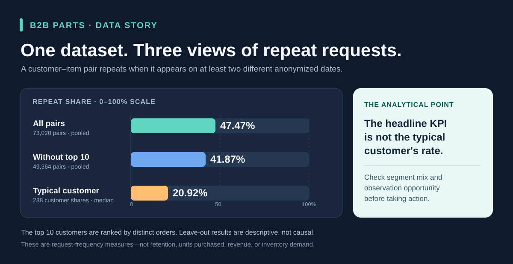

# Case study: When a repeat-request KPI hides the customer

## The decision question

A procurement team sees a 47.47% repeat-request share for industrial parts. Does that mean a typical customer requests nearly half of their parts again? **No.** This project checks the unit of analysis, compares pooled and customer-level views, and shows which follow-up questions the data can support.

## Evidence at a glance

| View | Result | Exact unit |
| --- | ---: | --- |
| Pooled repeat share | 34,664 / 73,020 = **47.47%** | Distinct customer–item pairs across all 238 customers; a pair repeats on at least two different anonymized dates. |
| Typical customer | **20.92%** median | Compute a repeat-pair share for each of 238 customers, then take the median. |
| Customers with at least 10 orders | **40.37%** median across 134 customers | Same customer-level calculation within a descriptive activity group. |
| Pooled share without the 10 highest-order customers | 20,671 / 49,364 = **41.87%** | Exclude 10 customers ranked by distinct orders, then pool the remaining 228 customers' pairs. |

The 10 highest-order customers account for **14,465 / 24,532 = 58.96%** of orders. Excluding them changes the pooled repeat share by **5.60 percentage points**. This is a sensitivity check: the customer mix affects the aggregate. It does not prove that high order volume causes repeat requests. The 20.92% median and 47.47% pooled rate also use different weighting, so their gap should not be read as an effect size.

## How the analysis was built

1. **Verify the source.** Six Zenodo CSVs match the published sizes and MD5 checksums. The 285,941 source lines contain 24,532 distinct order IDs; one order can have multiple lines. See the [data audit](data-audit.md).
2. **Choose defensible units.** Orders use distinct `ORDER_ID`; item frequency uses distinct order–item combinations; repeat requests use distinct customer–item pairs observed on at least two different dates. The [KPI dictionary](kpi-dictionary.md) lists the denominators.
3. **Preserve ambiguous source records.** There are 44,781 extra exact-match lines. Without a quantity or unique line ID, their business meaning is uncertain. The source stays intact, while the central KPIs use distinct units. See the [duplicate audit](duplicate-audit.md).
4. **Check the headline.** SQL views calculate pooled and customer-level rates. The [sensitivity query](../sql/08_portfolio_sensitivity.sql) ranks customers by orders and repeats the pooled calculation after leaving out the top 10. Reproduce it with `node scripts/run_checks.mjs data/b2b.sqlite sql/08_portfolio_sensitivity.sql` after the [local rebuild](reproduce.md).
5. **Communicate the result.** The [Power BI report](../powerbi/B2B_Parts_Demand_Overview.pbix) presents overview, concentration, repeat requests, and customer variation on four bilingual pages. Its last page is especially important for interpreting the 47.47% figure.

## What a business team could do next

- Check whether operations depend heavily on a few high-order customers. Order share is an exposure signal, not a customer-value or revenue measure.
- Compare repeat patterns among customers with similar order counts and observation windows before treating a pooled rate as a service-planning input.
- Join in quantities, item descriptions, inventory, lead times, suppliers, and costs before evaluating stock levels, supplier risk, or savings opportunities.

The data cannot identify actual purchase volume, spend, margins, stockouts, delivery reliability, or supplier performance. Request dates were shifted for anonymity, so plotted calendar years must not be matched to real market events. This is descriptive analysis, not a retention model, forecast, or causal study.

## Skills demonstrated and scope of ownership

The repository exposes the complete analytical trail: source checks, SQLite/SQL transformations, explicit metrics, validation, and a Power BI presentation. AI assisted with implementation and writing. The project is strongest when presented as a **reproducible analysis with careful judgment about what the data can and cannot say**. It should not be presented as independently deployed procurement software or as proof that the presenter built every component unaided.

## 中文简述

这个案例的核心并不是“再次请求率有 47.47%”，而是**这个总体指标不能直接代表典型客户**。按客户分别计算后的中位数只有 20.92%；排除订单最多的前 10 位客户后，合计比例变为 41.87%。这些数字使用不同的统计方式，反映客户结构和观察机会会影响解读，不能据此推断因果关系。项目展示了数据粒度核查、SQL 口径设计、敏感性分析、Power BI 沟通和结果边界；原始数据缺少数量、库存与供应商信息，所以不能直接制定补货方案。
